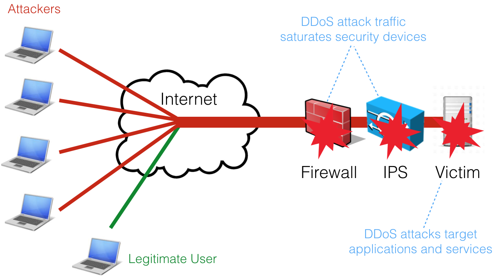

# nScrub Documentation {#nscrub-documentation}

nScrub is a DDoS mitigation system based on PF_RING ZC, able to operate at 10 Gigabit/s line-rate using a low-end system, and scale to Terabit/s building a modular architecture.

A DDoS (Distributed Denial of Service) attack is an attempt to make a service unavailable by overwhelming it with malicious traffic from multiple distributed sources.

Common routers, firewalls and IPSs are not designed to handle high volume of packets per second and are often the the first victim of the Denial of Service attacks. Specialised solutions are needed to protect the infrastructure, solutions that can not only route or bridge high packet rates but also able to filter and challenge malicious traffic.

Such dedicated solutions in the past where implemented by dedicated hardware with specially designed ASICs or FPGAs capable of handling high speed filtering.

nScrub is a software-based DDoS mitigation tool based on PF_RING and Zero Copy able to operate at 10 Gbps line rate (no matter the packet size) using commodity hardware (e.g. Intel NICs and standard servers).

nScrub is easy to configure, even for beginners and companies that never faced with DDoS until now. Affordable in terms of price, deployment, reporting. A looking glass to see the status of the network while mitigating attacks.

nScrub not only performs as good as a hardware based solution but provide a flexibility that makes it unique:

- Easy Deployment: nScrub can be implemented as bump in the wire (i.e. no BGP or traffic tunnelling necessary to deploy nScrub).
- Low Cost: very low TCO (Total Cost of Ownership).
- Modularity: extensibility for the definition of additional algorithms for traffic mitigation. They can be implemented through an API that allows developers to create their own mitigation facilities to be used in addition to those part of nScrub.
- Rich Detection: precise mitigation based on algorithms that try to determine whether the incoming traffic is real/legitimate.
- Auto-healing: automatic escalation during mitigation: when things get bad, the user has the ability to enable auto-escalation to put in place a proper reaction to threats.
- No hardware locking: nScrub can operate with multiple hardware vendors avoiding vendor locking.

The main features include:

- Support for asymmetric (i.e. ability to mitigate only one traffic direction, from Internet to the protected network) and symmetric (i.e. mitigate from Internet to the protected network, but also forward the outbound traffic) mode. Asymmetric mode allows also to deploy nScrub as a off-ramp solution (scrubbing center) by means of BGP re-routing.
- Detection of real/legitimate traffic by means of techniques that try to detect if the sender is real or not and the session is legitimate or not.
- Ability to monitor/visualise legitimate/good ingress traffic as well as discarded/bad traffic, both sampled or not, forwarding traffic to egress interfaces to be sent to monitoring machines or IDS (e.g. snort), or to be recorded and analysed at later stage.
- Ability to configure mitigation profiles per destinations (i.e. the network to protect) so that each host of the protected network can have a custom protection policy.
- Multi protocol application support including DNS, HTTP and HTTPS

**User's Guide**

- [Main Features](/features.md)
  - [Traffic enforcement](/features.md#traffic-enforcement)
  - [Multi-Tenancy](/features.md#multi-tenancy)
  - [Traffic Visibility](/features.md#traffic-visibility)
  - [Hw acceleration and Scalability](/features.md#hw-acceleration-and-scalability)
  - [UI](/features.md#ui)
- [Installation](/install.md)
  - [PF_RING](/install.md#pf-ring)
  - [nScrub](/install.md#nscrub)
- [Models and Licenses](/versions.md)
  - [License Setup](/versions.md#license-setup)
  - [EULA](/versions.md#eula)
- [Engine Configuration](/engine_conf.md)
  - [Basic Settings](/engine_conf.md#basic-settings)
  - [Host Connectivity/Routing](/engine_conf.md#host-connectivity-routing)
  - [CPU Affinity](/engine_conf.md#cpu-affinity)
  - [Traffic Monitoring](/engine_conf.md#traffic-monitoring)
  - [Advanced Settings](/engine_conf.md#advanced-settings)
  - [REST Server](/engine_conf.md#rest-server)
  - [Logging](/engine_conf.md#logging)
  - [Service](/engine_conf.md#service)
  - [Version and License](/engine_conf.md#version-and-license)
- [Working Modes](/working_modes.md)
  - [Transparent Bridge Mode](/working_modes.md#transparent-bridge-mode)
  - [Routing Mode](/working_modes.md#routing-mode)
- [Performance and Tuning](/tuning.md)
  - [Hardware Configuration](/tuning.md#hardware-configuration)
  - [Load Balancing](/tuning.md#load-balancing)
    - [Hardware Traffic Distribution (RSS)](/tuning.md#hardware-traffic-distribution-rss)
    - [Software Traffic Distribution (ZC)](/tuning.md#software-traffic-distribution-zc)
  - [CPU Affinity](/tuning.md#cpu-affinity)
    - [Time-Source Thread](/tuning.md#time-source-thread)
    - [Processing Threads](/tuning.md#processing-threads)
    - [Load Balancer Thread (Software Traffic Distribution only)](/tuning.md#load-balancer-thread-software-traffic-distribution-only)
  - [Zero-Copy TX and TX Offload](/tuning.md#zero-copy-tx-and-tx-offload)
- [Traffic Enforcement Configuration](/traffic_enforcement_conf.md)
  - [User Management](/traffic_enforcement_conf.md#user-management)
    - [Setting the REST API Password](/traffic_enforcement_conf.md#setting-the-rest-api-password)
    - [Changing the Password](/traffic_enforcement_conf.md#changing-the-password)
    - [Adding and Removing Users](/traffic_enforcement_conf.md#adding-and-removing-users)
    - [Password Reset (Emergency)](/traffic_enforcement_conf.md#password-reset-emergency)
  - [Traffic Enforcement Logic](/traffic_enforcement_conf.md#traffic-enforcement-logic)
    - [Profile-Based Traffic Inspection](/traffic_enforcement_conf.md#profile-based-traffic-inspection)
    - [WAN to LAN Traffic Flow (Inbound Traffic Inspection)](/traffic_enforcement_conf.md#wan-to-lan-traffic-flow-inbound-traffic-inspection)
    - [LAN to WAN Traffic Flow (Outbound Traffic)](/traffic_enforcement_conf.md#lan-to-wan-traffic-flow-outbound-traffic)
    - [Traffic Verification and Promotion Example](/traffic_enforcement_conf.md#traffic-verification-and-promotion-example)
    - [Configuration Best Practices](/traffic_enforcement_conf.md#configuration-best-practices)
  - [Victims definition](/traffic_enforcement_conf.md#victims-definition)
  - [Global Settings](/traffic_enforcement_conf.md#global-settings)
    - [Application version, configuration and status](/traffic_enforcement_conf.md#application-version-configuration-and-status)
    - [Stats](/traffic_enforcement_conf.md#stats)
    - [Configure system name](/traffic_enforcement_conf.md#configure-system-name)
    - [Configure system description](/traffic_enforcement_conf.md#configure-system-description)
    - [Configure global bypass](/traffic_enforcement_conf.md#configure-global-bypass)
    - [Read the neighbor table](/traffic_enforcement_conf.md#read-the-neighbor-table)
    - [Set WAN/LAN IP](/traffic_enforcement_conf.md#set-wan-lan-ip)
    - [Read the routing table](/traffic_enforcement_conf.md#read-the-routing-table)
    - [Update the routing table](/traffic_enforcement_conf.md#update-the-routing-table)
    - [Configure VLAN reforging](/traffic_enforcement_conf.md#configure-vlan-reforging)
    - [Read the VLAN reforging list](/traffic_enforcement_conf.md#read-the-vlan-reforging-list)
    - [Configure traffic mirroring](/traffic_enforcement_conf.md#configure-traffic-mirroring)
    - [Configure the runtime debug level](/traffic_enforcement_conf.md#configure-the-runtime-debug-level)
    - [Configure peer (MAC) policy](/traffic_enforcement_conf.md#configure-peer-mac-policy)
    - [Global Attackers Lists](/traffic_enforcement_conf.md#global-attackers-lists)
  - [Targets Management](/traffic_enforcement_conf.md#targets-management)
    - [Read targets list](/traffic_enforcement_conf.md#read-targets-list)
    - [Add/del subnets from targets](/traffic_enforcement_conf.md#add-del-subnets-from-targets)
    - [Delete a target by name](/traffic_enforcement_conf.md#delete-a-target-by-name)
    - [Set a description for the target](/traffic_enforcement_conf.md#set-a-description-for-the-target)
    - [Configure VLAN reforging for traffic towards the target](/traffic_enforcement_conf.md#configure-vlan-reforging-for-traffic-towards-the-target)
    - [Configure target type](/traffic_enforcement_conf.md#configure-target-type)
    - [Read target stats](/traffic_enforcement_conf.md#read-target-stats)
  - [Attackers Management](/traffic_enforcement_conf.md#attackers-management)
    - [Read attackers](/traffic_enforcement_conf.md#read-attackers)
    - [Add/Delete attackers](/traffic_enforcement_conf.md#add-delete-attackers)
    - [Delete an attacker list](/traffic_enforcement_conf.md#delete-an-attacker-list)
    - [Purge all attackers](/traffic_enforcement_conf.md#purge-all-attackers)
    - [List all attackers list](/traffic_enforcement_conf.md#list-all-attackers-list)
    - [Search attackers](/traffic_enforcement_conf.md#search-attackers)
    - [Read dynamic list](/traffic_enforcement_conf.md#read-dynamic-list)
    - [Purge dynamic list](/traffic_enforcement_conf.md#purge-dynamic-list)
    - [Configure dynamic list autopurging](/traffic_enforcement_conf.md#configure-dynamic-list-autopurging)
    - [Configure dynamic list expiration for autopurging](/traffic_enforcement_conf.md#configure-dynamic-list-expiration-for-autopurging)
    - [Batch add/delete attackers](/traffic_enforcement_conf.md#batch-add-delete-attackers)
  - [Global Attackers Management](/traffic_enforcement_conf.md#global-attackers-management)
    - [Read global attackers](/traffic_enforcement_conf.md#read-global-attackers)
    - [Add/Delete global attackers](/traffic_enforcement_conf.md#add-delete-global-attackers)
    - [Delete a global attacker list](/traffic_enforcement_conf.md#delete-a-global-attacker-list)
    - [Purge all global attackers](/traffic_enforcement_conf.md#purge-all-global-attackers)
    - [List all global attackers lists](/traffic_enforcement_conf.md#list-all-global-attackers-lists)
    - [Batch add/delete global attackers](/traffic_enforcement_conf.md#batch-add-delete-global-attackers)
    - [Ignore the global attackers list for a target](/traffic_enforcement_conf.md#ignore-the-global-attackers-list-for-a-target)
  - [Targets Profiles Configuration](/traffic_enforcement_conf.md#targets-profiles-configuration)
    - [Configure bypass](/traffic_enforcement_conf.md#configure-bypass)
    - [Configure default action](/traffic_enforcement_conf.md#configure-default-action)
    - [Rate limiting per source/dest](/traffic_enforcement_conf.md#rate-limiting-per-source-dest)
    - [Configure all traffic drop/accept](/traffic_enforcement_conf.md#configure-all-traffic-drop-accept)
    - [Read UDP/TCP/ICMP policies](/traffic_enforcement_conf.md#read-udp-tcp-icmp-policies)
    - [Configure UDP/TCP/ICMP drop/accept](/traffic_enforcement_conf.md#configure-udp-tcp-icmp-drop-accept)
    - [Configure GRE Signaling drop/accept](/traffic_enforcement_conf.md#configure-gre-signaling-drop-accept)
    - [Configure SYN check engage mode](/traffic_enforcement_conf.md#configure-syn-check-engage-mode)
    - [Configure TCP traffic threshold](/traffic_enforcement_conf.md#configure-tcp-traffic-threshold)
    - [Configure SYN check method](/traffic_enforcement_conf.md#configure-syn-check-method)
    - [Configure SSL SYN check method](/traffic_enforcement_conf.md#configure-ssl-syn-check-method)
    - [Configure SYN RFC check method threshold](/traffic_enforcement_conf.md#configure-syn-rfc-check-method-threshold)
    - [Enable whitelisting of sessions only](/traffic_enforcement_conf.md#enable-whitelisting-of-sessions-only)
    - [Auto-engage whitelisting of sessions only](/traffic_enforcement_conf.md#auto-engage-whitelisting-of-sessions-only)
    - [Configure SYN rate limiting](/traffic_enforcement_conf.md#configure-syn-rate-limiting)
    - [Configure Auto-Blacklist](/traffic_enforcement_conf.md#configure-auto-blacklist)
    - [Configure SYN-ACK rate limiting](/traffic_enforcement_conf.md#configure-syn-ack-rate-limiting)
    - [Configure SYN-ACK session whitelisting](/traffic_enforcement_conf.md#configure-syn-ack-session-whitelisting)
    - [Configure SYN-ACK TCP-Amplification protection](/traffic_enforcement_conf.md#configure-syn-ack-tcp-amplification-protection)
    - [Drop TCP SYN with seq num 0](/traffic_enforcement_conf.md#drop-tcp-syn-with-seq-num-0)
    - [Drop TCP SYN with no options](/traffic_enforcement_conf.md#drop-tcp-syn-with-no-options)
    - [Drop TCP SYN packets with payload](/traffic_enforcement_conf.md#drop-tcp-syn-packets-with-payload)
    - [Set drop/accept policy per UDP/TCP src/dst port](/traffic_enforcement_conf.md#set-drop-accept-policy-per-udp-tcp-src-dst-port)
    - [Set min/max UDP payload length](/traffic_enforcement_conf.md#set-min-max-udp-payload-length)
    - [Drop UDP fragments](/traffic_enforcement_conf.md#drop-udp-fragments)
    - [Set min/max UDP fragments payload length](/traffic_enforcement_conf.md#set-min-max-udp-fragments-payload-length)
    - [Drop UDP with checksum0](/traffic_enforcement_conf.md#drop-udp-with-checksum0)
    - [Configure UDP rate limiting](/traffic_enforcement_conf.md#configure-udp-rate-limiting)
    - [Set drop policy per ICMP type](/traffic_enforcement_conf.md#set-drop-policy-per-icmp-type)
    - [Set drop policy per TTL values](/traffic_enforcement_conf.md#set-drop-policy-per-ttl-values)
    - [Configure DNS check method](/traffic_enforcement_conf.md#configure-dns-check-method)
    - [Configure DNS rate limiting](/traffic_enforcement_conf.md#configure-dns-rate-limiting)
    - [Configure DNS traffic threshold](/traffic_enforcement_conf.md#configure-dns-traffic-threshold)
    - [Set drop policy per DNS request type](/traffic_enforcement_conf.md#set-drop-policy-per-dns-request-type)
    - [Set max DNS subdomain length](/traffic_enforcement_conf.md#set-max-dns-subdomain-length)
    - [Hex/string pattern match](/traffic_enforcement_conf.md#hex-string-pattern-match)
    - [Read active patterns](/traffic_enforcement_conf.md#read-active-patterns)
    - [HTTP request field match](/traffic_enforcement_conf.md#http-request-field-match)
    - [Read active HTTP request fields](/traffic_enforcement_conf.md#read-active-http-request-fields)
    - [Add allowed HTTP hosts](/traffic_enforcement_conf.md#add-allowed-http-hosts)
    - [Read active HTTP hosts](/traffic_enforcement_conf.md#read-active-http-hosts)
  - [Users Management](/traffic_enforcement_conf.md#users-management)
    - [Read users list](/traffic_enforcement_conf.md#read-users-list)
    - [Add/del/update users](/traffic_enforcement_conf.md#add-del-update-users)
- [Traffic Visibility](/monitoring.md)
  - [Statistics](/monitoring.md#statistics)
  - [Traffic Monitoring](/monitoring.md#traffic-monitoring)
    - [Traffic Analysis with tcpdump](/monitoring.md#traffic-analysis-with-tcpdump)
    - [Traffic Analysis with ntopng](/monitoring.md#traffic-analysis-with-ntopng)
  - [Events](/monitoring.md#events)
- [Command line tools](/cli.md)
  - [nscrub-cli](/cli.md#nscrub-cli)
  - [nscrub-export](/cli.md#nscrub-export)
- [Utilities and Testing](/testing.md)
  - [SYN Mitigation](/testing.md#syn-mitigation)
  - [Throughput](/testing.md#throughput)
- [Hardware Bypass Support](/hw_bypass.md)
  - [Silicom Adapters](/hw_bypass.md#silicom-adapters)

**Other Products**

- [ntopng](https://www.ntop.org/guides/ntopng/)
- [nProbe](https://www.ntop.org/guides/nprobe/)
- [nProbe Cento](https://www.ntop.org/guides/cento/)
- [n2disk](https://www.ntop.org/guides/n2disk/)
- [nDPI](https://www.ntop.org/guides/nDPI/)
- [PF_RING](https://www.ntop.org/guides/pf_ring/)
- [nEdge](https://www.ntop.org/guides/nedge/)
- [nScrub](https://www.ntop.org/guides/nscrub/)
- [nBox](https://www.ntop.org/guides/nbox/)
- [nTap](https://www.ntop.org/guides/ntap/)

